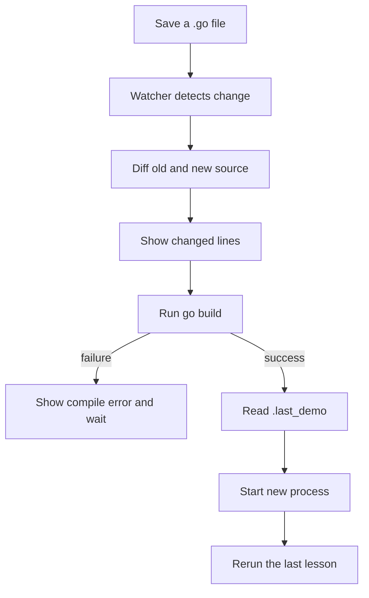

# Go Learning Lab

> A hands-on Go starter project: edit, save, and see the result immediately.

[中文](README.md) · [English](README.en.md) · [Learning Plan (中文)](学习计划.md) · [中文新手指引](docs/beginner-guide.zh-CN.md) · [English Guide](docs/beginner-guide.en.md)


---

## What is this?

An interactive Go learning project for beginners. Every example lives in a single [test.go](test.go). Run it, pick a topic from the menu, and experiment with the code.

The project also includes a zero-dependency hot-reload tool. When you save a source file, it shows the changed lines, rebuilds the program, and reruns the lesson you selected last time.

Hot reload is the recommended workflow. If you only want a one-off run, you can skip the watcher and use `go run test.go` directly.

Best for:

- people learning Go for the first time;
- learners who understand concepts faster by changing code and seeing output;
- anyone who wants a small, runnable Go starter template.

> The examples were tested with Go 1.27.3 on Windows amd64. The code is compatible with Go 1.21+.

---

## Features

- **8 learning topics**: variables and types, control flow, functions, slices/maps, structs, interfaces and errors, generics, concurrency.
- **Interactive menu**: enter a number to run a lesson.
- **Built-in exercises**: every lesson ends with something to try.
- **Save-to-run (recommended)**: the watcher rebuilds, restarts, and reruns the last lesson.
- **Manual mode available**: skip the watcher with `go run test.go`.
- **Change highlighting**: source diffs with `-` / `+`, line numbers, context, and red/green colors.
- **No third-party dependencies**: only the Go standard library.
- **Cross-platform**: Windows, macOS, and Linux; `dev.bat` is Windows-only.
- **Bilingual docs**: Chinese and English beginner guides.
- **GitHub Actions CI**: `gofmt`, `go vet`, `go test`, and `go build`.

---

## Quick start

> Hot reload is recommended. For a one-off run, jump to step 4, "Run without hot reload".

You only need Go 1.21+, a terminal, and a text editor to get started. Git is needed only for `git clone` and publishing to GitHub.

### 1. Install Go

Go 1.21 or newer is required:

```bash
go version
```

If `go` is not found, install Go and reopen your terminal: <https://go.dev/dl/>

### 2. Get the project

```bash
git clone https://github.com/neumannfeng/studyGo.git
cd studyGo
```

You can also use **Code → Download ZIP** on GitHub and extract the archive. `git clone` requires Git: <https://git-scm.com/downloads>.

### 3. Recommended: enable hot reload

Hot reload is built into `tools/hotreload`. **You do not need air, an editor plugin, or any extra dependency.** Once it is running, saving a `.go` file rebuilds the program and reruns the lesson you selected last time.

#### 3.1 Open a terminal in the project folder

Windows:

1. Open the `studyGo` folder in File Explorer;
2. type `powershell` in the address bar and press Enter (or Shift+right-click in the folder and choose “Open PowerShell window here”);
3. confirm the prompt looks like `PS H:\project\studyGo>`.

macOS / Linux:

```bash
cd /path/to/studyGo
pwd
```

The output of `pwd` should end with `studyGo`. Replace the path with your actual location.

> Git is not required just to run the project. If Git is not installed, use **Code → Download ZIP** on GitHub. Git is only needed for `git clone` and publishing to GitHub.

#### 3.2 Start hot reload

Windows:

```powershell
.\dev.bat
```

Use `.\dev.bat`, not `dev.bat`. The leading `.\` means “the current folder”.

You can also double-click `dev.bat` in File Explorer; it changes to the project folder automatically. Starting it from a terminal is recommended so you can see the full compile and diff output.

macOS / Linux:

```bash
go run ./tools/hotreload
```

> Do not run two watchers at the same time. If one is already running, press `Ctrl+C` in that window first.
>
> If `.bat` files are blocked by security software or cannot run, use `go run ./tools/hotreload` instead. You do not need to change the PowerShell execution policy.

#### 3.3 Confirm that it started

The first launch compiles the program and may take a few seconds. A successful start looks like:

```text
Go 热重载已启动
  监听： H:\project\studyGo
  保存 .go 文件后自动重编译，并重跑上次选择的小节
  按 Ctrl+C 停止

[启动] 首次编译...
[启动] 编译成功

════════════════════════════════════════════════════════════
  Go 语言学习实验室 · test.go
════════════════════════════════════════════════════════════
...
请选择>
```

If you see `[启动] 编译失败`, fix the reported error and save the file. The watcher retries automatically; you do not need to restart it.

#### 3.4 Select a lesson

At the `请选择>` prompt:

- enter `9` to see every example;
- enter `1` to start with variables, constants, and basic types.

After the overview, enter `1` again so later saves rerun lesson 1 instead of the whole program.

> `请选择>` is the learning program's menu, not the PowerShell prompt. You can only enter `1`–`9` or `q` there. Do not type shell commands such as `.\dev.bat` at that prompt.

#### 3.5 Edit the code and save

Open [test.go](test.go) in VS Code, GoLand, or any text editor. Find this line in lesson 1:

```go
var age int = 8
```

Change it to:

```go
var age int = 9
```

Press `Ctrl+S` to save (on macOS, `Cmd+S`). **Hot reload is triggered only when the file is saved.**

The terminal shows the diff and reruns the lesson:

```text
────────────────────────────────────────────────────────────
[检测] test.go 发生变化
────────────────────────────────────────────────────────────
[变更]  文件：test.go    -1 行 / +1 行
  行号 │ 内容
   167 |
   168 | 	var name string = "Gopher"
-  169 | 	var age int = 8
+  169 | 	var age int = 9
   170 | 	var height float64 = 1.75
   171 | 	var isReady bool = true

[编译] 成功
[运行] 自动重跑第 1 节（上次选择）
```

The menu labels are in Chinese because the learning content is in Chinese, but the workflow is simple: the number is the lesson, `q` quits, and `Ctrl+C` stops the watcher.

You can place the editor and terminal side by side: edit on the left, watch the result on the right. **Do not close the terminal that is running the watcher.**

#### 3.6 Quit the program and stop the watcher

| Action | Effect |
| --- | --- |
| Enter `q` | Quit the current learning program; the watcher keeps running and restarts it when you save |
| Press `Ctrl+C` | Stop the watcher and return to the normal shell prompt |
| Close the terminal window | Stop both the program and the watcher |

Hot reload means “rebuild and start a new process”, so variables and in-memory state are reset. This is expected.

#### 3.7 Nothing happens after saving?

Check these in order:

1. Was the file actually saved? Look for an unsaved dot in the editor title, or press `Ctrl+S` again.
2. Are you editing [test.go](test.go) in the project root?
3. Is the watcher still running in the terminal?
4. Are multiple watcher windows running?
5. Is the terminal sitting at `请选择>`? That usually means the program is running normally. Just save the file; the watcher will stop the old process and start a new one.

See the [FAQ](#faq) or the [English beginner guide](docs/beginner-guide.en.md) for more help.

> The selected lesson is stored in `.last_demo`. Delete that file to disable automatic reruns.

### 4. Fallback: run without hot reload

If you only want a one-off run, or the watcher cannot start in your environment, run:

```bash
go run test.go
```

You can also run a single lesson directly:

```bash
go run test.go -demo 1
```

This mode has no file watcher and no automatic rerun. After editing, quit the program (`q` or `Ctrl+C`) and run the command again.

| Mode | Best for | Manual rerun? |
| --- | --- | --- |
| Hot reload (recommended) | Frequent edits and fast feedback | No |
| Manual run (fallback) | One-off runs or troubleshooting the watcher | Yes |

---

## Menu

| # | Topic | What you will learn |
| --- | --- | --- |
| 1 | Variables, constants, basic types | `var`, `:=`, zero values, `%T`/`%v`, conversions |
| 2 | Conditions, loops, switch | `if`, three forms of `for`, `switch`, `range` |
| 3 | Functions, multiple returns, closures, defer | multiple returns, variadic args, closures, `defer` |
| 4 | Slices, maps, range | `append`, `len`/`cap`, map lookup, delete |
| 5 | Structs, methods, pointers | value vs pointer receivers, value copies |
| 6 | Interfaces, errors, errors.Is/As | implicit interfaces, sentinel errors, wrapping |
| 7 | Generics | type parameters, constraints, generic functions |
| 8 | goroutine, channel, WaitGroup | starting goroutines, channels, closing, waiting |
| 9 | Run every example | quick overview |

Each lesson includes exercises. Try them before moving on.

---

## Project layout

```text
studyGo/
├── README.md                    # Chinese README
├── README.en.md                 # English README (this file)
├── LICENSE                      # MIT License
├── CONTRIBUTING.md              # Contribution guide
├── 学习计划.md                   # 4-week learning plan (Chinese)
├── go.mod                       # Go module
├── test.go                      # 8 topics + interactive menu
├── dev.bat                      # One-command hot reload (Windows)
├── docs/
│   ├── beginner-guide.zh-CN.md  # Chinese beginner guide
│   └── beginner-guide.en.md     # English beginner guide
├── practice/
│   └── README.md                # Weekly project layout
├── tools/hotreload/
│   ├── main.go                  # Watch, build, restart
│   ├── diff.go                  # Line diff and highlighting
│   ├── console_windows.go       # ANSI support for Windows consoles
│   └── console_other.go         # No-op for other platforms
└── .github/workflows/ci.yml     # GitHub Actions CI
```

---

## How hot reload works

Go is compiled, so a running process cannot receive new source code. The watcher implements “hot reload” by rebuilding and restarting:



The diagram omits two details: build output goes to `.reload/`, and the new process reruns the last lesson with `-demo N`.

In one line: **save → detect → diff → build → read last choice → restart and rerun**.

Key files:

- `.last_demo`: written by `test.go`, read by the watcher;
- `.reload/`: build output, ignored by `.gitignore`;
- `tools/hotreload/`: watcher and diff logic, standard library only.

---

## Learning path

See the full [4-week learning plan (Chinese)](学习计划.md).

| Week | Theme | Weekend project |
| --- | --- | --- |
| 1 | Syntax: variables, control flow, functions, slices/maps | CLI temperature converter |
| 2 | Modeling: structs, methods, interfaces, errors | In-memory contacts manager |
| 3 | Engineering: files, JSON, tests, packages | JSON-backed todo CLI |
| 4 | Concurrency and HTTP: goroutines, channels, net/http | Concurrent URL health checker |

Start with the [English beginner guide](docs/beginner-guide.en.md) for installation, running, editing, troubleshooting, and publishing to GitHub.

---

## Commands

```bash
# Recommended: hot reload (rebuild and rerun on save)
.\dev.bat                      # Windows
go run ./tools/hotreload       # macOS / Linux

# Fallback: manual run without hot reload
go run test.go
go run test.go -demo 1         # run lesson 1 directly

# Format the main file
gofmt -w test.go

# Static checks and compile tests
go vet ./...
go test ./...
```

---

## FAQ

### Nothing happens after saving

Make sure `dev.bat` or `go run ./tools/hotreload` is running, and edit a `.go` file in the project root. `q` only quits the program; it does not stop the watcher.

### Why does the program restart?

A Go program runs as a compiled binary. Editing source does not change the running process. The watcher rebuilds and starts a new process, so in-memory state is reset. That is expected.

### No colors?

Colors are enabled only for terminals that support ANSI. The watcher tries to enable ANSI on classic Windows consoles and falls back to plain `-` / `+` markers if that fails. Setting `NO_COLOR` also disables colors.

### `.reload` cannot be deleted

An old process or antivirus scanner may still hold the binary. Press `Ctrl+C` to stop the watcher, close the terminal, and try again. Each build uses a new filename, so a locked old binary does not block the next build.

### `dev.bat` does not run

In PowerShell, use `.\dev.bat`. If batch files are restricted, run `go run ./tools/hotreload` directly instead.

### The `dev.bat` window closes immediately

The watcher probably failed during startup. Run `.\dev.bat` from a PowerShell window inside the project folder so the error stays visible. You can also run `go run ./tools/hotreload` to see the full output.

### `go` is not found

Close and reopen the terminal after installing Go. On Windows, check that the Go `bin` directory is in `Path`; on macOS/Linux, check that `/usr/local/go/bin` is in `PATH`. See the [English beginner guide](docs/beginner-guide.en.md) for details.

### Chinese text looks garbled

On a classic Windows console, try:

```powershell
chcp 65001
```

Then run the program again. Windows Terminal usually handles UTF-8 without extra configuration.

### Does it need the internet?

No. The project has no third-party dependencies. You only need the internet to install Go or clone the repository.

---

## Publish to GitHub

The repository is ready for GitHub: `.gitignore`, `LICENSE`, CI, and bilingual docs are included. See the step-by-step guide:

- [中文新手指引 · 上传到 GitHub](docs/beginner-guide.zh-CN.md)
- [English Guide · Publish to GitHub](docs/beginner-guide.en.md)

Quick version:

```bash
git init -b main
git add .
git commit -m "feat: initial Go learning lab"
git remote add origin https://github.com/neumannfeng/studyGo.git
git push -u origin main
```

The URLs use the GitHub username `neumannfeng`; update `studyGo` if you rename the repository.

---

## Contributing

Issues and pull requests are welcome. Read [CONTRIBUTING.md](CONTRIBUTING.md) first, then run:

```bash
gofmt -w .
go vet ./...
go test ./...
```

---

## License

[MIT](LICENSE)
