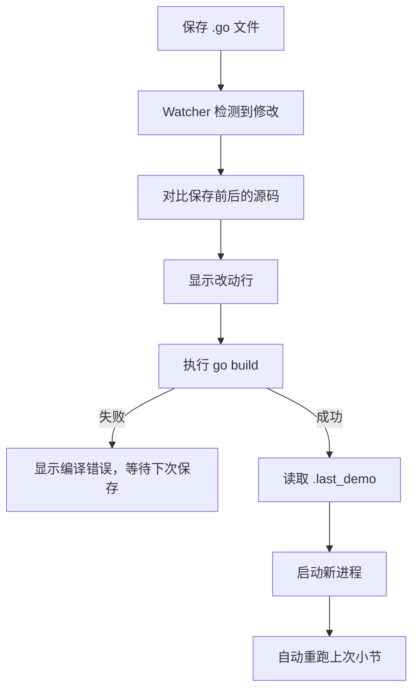

# Go 语言学习实验室

> 一个可以边改边学、保存即运行的 Go 入门项目。

[中文](README.md) · [English](README.en.md) · [学习计划](学习计划.md) · [新手指引](docs/beginner-guide.zh-CN.md) · [English Guide](docs/beginner-guide.en.md)


---

## 这是什么

这是一个面向 Go 初学者的交互式练习项目。全部示例都在一个 [test.go](test.go) 里，运行后通过菜单选择主题，边看代码、边运行、边修改。

项目内置一个零第三方依赖的热重载工具：保存源码后，它会自动显示改动的行、重新编译、重跑你上次选择的小节，不需要手动退出再运行。

推荐直接使用热重载；如果只想临时运行一次，也可以不启动 watcher，直接 `go run test.go`。

适合：

- 第一次系统学习 Go 的人；
- 想通过“改代码看结果”理解语法的人；
- 想找一个可直接运行的 Go 入门模板的人。

> 当前示例环境：Go 1.27.3 / Windows amd64。代码本身兼容 Go 1.21+。

---

## 功能

- **8 个学习主题**：变量与类型、流程控制、函数、切片/map、结构体、接口与错误、泛型、并发。
- **交互式菜单**：输入编号即可运行对应示例。
- **内置练习**：每节末尾都有可以立即动手的练习题。
- **保存即运行（推荐）**：热重载工具自动重编译、重启并重跑上次小节。
- **保留手动模式**：不想用热重载时，可直接 `go run test.go`。
- **变更高亮**：用 `-` / `+` 和红/绿颜色显示修改的源码行，附行号与上下文。
- **零第三方依赖**：只使用 Go 标准库。
- **跨平台**：Windows、macOS、Linux 均可运行；`dev.bat` 仅用于 Windows。
- **中英双语文档**：中文和英文新手指引。
- **GitHub Actions CI**：自动执行 `gofmt`、`go vet`、`go test`、`go build`。

---

## 快速开始

> 推荐使用热重载；如果只想临时运行一次，可以直接看第 4 步的“手动运行”。

开始前你只需要：Go 1.21+、一个终端、一个文本编辑器。Git 只有在 `git clone` 和上传 GitHub 时才需要。

### 1. 准备环境

需要 Go 1.21 或更高版本：

```bash
go version
```

如果提示找不到 `go`，先安装 Go 并重新打开终端：<https://go.dev/dl/>

### 2. 获取项目

```bash
git clone https://github.com/neumannfeng/studyGo.git
cd studyGo
```

也可以直接在 GitHub 页面点击 **Code → Download ZIP**，解压后进入目录。使用 `git clone` 需要先安装 Git：<https://git-scm.com/downloads>。

### 3. 推荐：启用热重载

热重载已经内置在 `tools/hotreload`，**不需要安装 air、插件或额外依赖**。启动后，保存 `.go` 文件就会自动重新编译，并重跑你上次选择的小节。

#### 3.1 打开终端，进入项目目录

Windows：

1. 在文件资源管理器中打开 `studyGo` 文件夹；
2. 在地址栏输入 `powershell` 并按回车（也可以在文件夹空白处按住 `Shift` 再右键，选择“在此处打开 PowerShell 窗口”）；
3. 确认提示符类似 `PS H:\project\studyGo>`。

macOS / Linux：

```bash
cd /path/to/studyGo
pwd
```

`pwd` 的输出应该以 `studyGo` 结尾。路径要替换成你自己的实际位置。

> 只运行项目不需要 Git。没有安装 Git 也可以使用 **Code → Download ZIP**；Git 只在 `git clone` 和上传 GitHub 时需要。

#### 3.2 启动热重载

Windows：

```powershell
.\dev.bat
```

注意是 `.\dev.bat`，开头的 `.\` 表示“当前目录”。只输入 `dev.bat` 可能提示找不到命令。

也可以直接在文件资源管理器里双击 `dev.bat`，脚本会自动切换到项目目录。不过建议从终端启动，这样能看到完整的编译和 diff 输出。

macOS / Linux：

```bash
go run ./tools/hotreload
```

> 不要同时开两个热重载。如果已经开了一个，先在原窗口按 `Ctrl+C` 停止。
>
> 如果 `.bat` 被安全软件拦截或无法运行，直接改用 `go run ./tools/hotreload`，不需要修改 PowerShell 执行策略。

#### 3.3 确认启动成功

第一次启动会先编译，可能需要几秒钟。成功时终端大致如下：

```text
Go 热重载已启动
  监听： H:\project\studyGo
  保存 .go 文件后自动重编译，并重跑上次选择的小节
  按 Ctrl+C 停止

[启动] 首次编译...
[启动] 编译成功

════════════════════════════════════════════════════════════
  Go 语言学习实验室 · test.go
════════════════════════════════════════════════════════════
...
请选择>
```

如果看到 `[启动] 编译失败`，先根据错误信息修复代码并保存；热重载会自动重试，不需要重新启动。

#### 3.4 先选择一个学习小节

在 `请选择>` 后输入：

- `9`：先看全部示例；
- `1`：从变量、常量与基本类型开始。

看完总览后建议再输入 `1`，这样之后保存时会自动重跑第 1 节，不会每次都跑全部示例。

> `请选择>` 是学习程序的菜单，不是 PowerShell 提示符。这里只能输入 `1`–`9` 或 `q`，不要在这里输入 `.\dev.bat` 等系统命令。

#### 3.5 修改代码并保存

用 VS Code、GoLand 或任意文本编辑器打开 [test.go](test.go)，找到第 1 节里的：

```go
var age int = 8
```

改成：

```go
var age int = 9
```

按 `Ctrl+S` 保存（macOS 是 `Cmd+S`）。**只有保存文件才会触发热重载**。

终端会自动显示改动并重跑：

```text
────────────────────────────────────────────────────────────
[检测] test.go 发生变化
────────────────────────────────────────────────────────────
[变更]  文件：test.go    -1 行 / +1 行
  行号 │ 内容
   167 |
   168 | 	var name string = "Gopher"
-  169 | 	var age int = 8
+  169 | 	var age int = 9
   170 | 	var height float64 = 1.75
   171 | 	var isReady bool = true

[编译] 成功
[运行] 自动重跑第 1 节（上次选择）
```

然后直接看到新的变量表：

```text
  变量值：
    name       = Gopher         (string)
    age        = 9              (int)
    height     = 1.75           (float64)
    ready      = true           (bool)
```

编辑器和终端可以并排摆放：左边改代码，右边看结果。**不要关闭正在运行热重载的终端窗口**。

#### 3.6 退出程序与停止热重载

| 操作 | 效果 |
| --- | --- |
| 输入 `q` | 只退出当前学习程序，热重载仍在监听；保存代码会重新启动 |
| 按 `Ctrl+C` | 停止热重载，回到普通终端提示符 |
| 关闭终端窗口 | 同时停止程序和热重载 |

热重载的本质是“重新编译 + 启动新进程”，所以程序里的变量和内存状态会重置，这是正常的。

#### 3.7 保存后没有反应？

按顺序检查：

1. 文件是否真的保存了（标题栏没有未保存的圆点，或按一次 `Ctrl+S`）；
2. 修改的是不是项目根目录下的 [test.go](test.go)；
3. 终端里是否还显示热重载正在运行；
4. 是否同时开了多个热重载窗口；
5. 终端是否停在 `请选择>`：这通常说明程序正常运行，直接保存文件即可，热重载会结束旧进程并重新启动。

更多问题见下方[常见问题](#常见问题)，或查看[中文新手指引](docs/beginner-guide.zh-CN.md)。

> 第一次选择后，编号会写入 `.last_demo`。删除这个文件可以取消“自动重跑上次小节”。

### 4. 备用：不带热重载的手动运行

如果只想临时运行一次，或当前环境无法启动 watcher，可以直接运行：

```bash
go run test.go
```

也可以直接运行某一节：

```bash
go run test.go -demo 1
```

这种方式没有文件监听和自动重跑：每次修改代码后，需要退出程序（`q` 或 `Ctrl+C`）并重新执行命令。

| 方式 | 适合场景 | 是否需要手动重跑 |
| --- | --- | --- |
| 热重载（推荐） | 边改边学、频繁修改 | 否 |
| 手动运行（备用） | 临时查看、排查 watcher 问题 | 是 |

---

## 菜单

| 编号 | 主题 | 你会学到 |
| --- | --- | --- |
| 1 | 变量、常量与基本类型 | `var`、`:=`、零值、`%T`/`%v`、类型转换 |
| 2 | 条件、循环与 switch | `if`、三种 `for`、`switch`、`range` |
| 3 | 函数、多返回值、闭包与 defer | 多返回值、可变参数、闭包、`defer` |
| 4 | 切片、map 与 range | `append`、`len`/`cap`、map 查找、删除 |
| 5 | 结构体、方法与指针 | 值接收者、指针接收者、值拷贝 |
| 6 | 接口、错误处理与 errors.Is/As | 隐式接口、哨兵错误、错误包装 |
| 7 | 泛型 | 类型参数、类型约束、泛型函数 |
| 8 | goroutine、channel 与 WaitGroup | 并发启动、channel、关闭与等待 |
| 9 | 运行全部示例 | 快速总览 |

每个小节都有练习，建议先独立完成练习，再看下一节。

---

## 项目结构

```text
studyGo/
├── README.md                    # 中文 README（本文件）
├── README.en.md                 # English README
├── LICENSE                      # MIT License
├── CONTRIBUTING.md              # 贡献指南
├── 学习计划.md                   # 4 周学习计划
├── go.mod                       # Go module
├── test.go                      # 8 个学习主题 + 交互菜单
├── dev.bat                      # Windows 一键热重载
├── docs/
│   ├── beginner-guide.zh-CN.md  # 中文新手指引
│   └── beginner-guide.en.md     # English beginner guide
├── practice/
│   └── README.md                # 四个周项目的目录说明
├── tools/hotreload/
│   ├── main.go                  # 文件监听、编译、重启
│   ├── diff.go                  # 源码逐行 diff 与高亮
│   ├── console_windows.go       # Windows ANSI 颜色支持
│   └── console_other.go         # 非 Windows 的空实现
└── .github/workflows/ci.yml     # GitHub Actions CI
```

---

## 热重载是怎么工作的

Go 是编译型语言，不能直接替换已经运行进程里的代码。所谓“热重载”，本质上是：



图中省略了两个细节：编译产物写入 `.reload/`，新进程通过 `-demo N` 重跑上次选择的小节。

一句话概括：**保存 → 检测 → diff → 编译 → 读取上次选择 → 重启并重跑**。

关键文件：

- `.last_demo`：保存最后一次选择的编号，由 `test.go` 写入，被 watcher 读取；
- `.reload/`：编译产物目录，已被 `.gitignore` 忽略；
- `tools/hotreload/`：监听和重启逻辑，不依赖第三方库。

---

## 学习路线

完整计划见 [学习计划.md](学习计划.md)。

| 周次 | 主题 | 周末项目 |
| --- | --- | --- |
| 第 1 周 | 语法地基：变量、流程、函数、切片/map | 命令行温度转换器 |
| 第 2 周 | 数据建模：结构体、方法、接口、错误 | 内存版通讯录 |
| 第 3 周 | 工程化：文件、JSON、测试、多包 | JSON 持久化待办 |
| 第 4 周 | 并发与 Web：goroutine、channel、HTTP | 并发 URL 健康检查器 |

第一次使用建议先读 [中文新手指引](docs/beginner-guide.zh-CN.md)，里面包含安装、运行、改代码、排错和上传到 GitHub 的完整步骤。

---

## 常用命令

```bash
# 推荐：热重载（保存后自动重跑上次小节）
.\dev.bat                      # Windows
go run ./tools/hotreload       # macOS / Linux

# 备用：不带热重载，手动运行
go run test.go
go run test.go -demo 1         # 直接运行第 1 节

# 格式化主文件
gofmt -w test.go

# 静态检查与编译测试
go vet ./...
go test ./...
```

---

## 常见问题

### 保存后没有自动运行？

确认你启动的是 `dev.bat` 或 `go run ./tools/hotreload`，并且修改的是项目根目录下的 `.go` 文件。`q` 只会退出程序，不会停止监听。

### 为什么修改代码后要重启？

Go 程序运行的是编译后的二进制，源码修改不会影响已经启动的进程。watcher 的做法是自动重新编译并启动新进程，所以内存中的变量会重置，这是正常现象。

### 没有颜色？

颜色只在支持 ANSI 的终端中启用。Windows 传统控制台会尝试自动开启；如果开启失败，仍然会显示 `-` / `+` 标记，不影响阅读。设置了 `NO_COLOR` 环境变量也会关闭颜色。

### `.reload` 删不掉？

通常是旧的测试进程或杀毒软件仍在占用二进制文件。先按 `Ctrl+C` 停止 watcher，关闭相关终端后再删除。热重载每次构建都会使用新的文件名，不会因为旧文件被占用而无法编译。

### `dev.bat` 无法执行？

在 PowerShell 中使用 `.\dev.bat`，不要只输入 `dev.bat`。如果系统禁止运行脚本，`.bat` 不受 PowerShell 执行策略限制；仍然失败时可直接运行 `go run ./tools/hotreload`。

### 双击 `dev.bat` 后窗口一闪而过？

通常说明启动时遇到了错误。请从 PowerShell 进入项目目录后运行 `.\dev.bat`，这样错误信息会留在窗口中。也可以直接运行 `go run ./tools/hotreload` 查看完整输出。

### `go` 找不到？

安装 Go 后关闭并重新打开终端。Windows 检查“系统属性 → 环境变量 → Path”是否包含 Go 的 `bin` 目录；macOS/Linux 检查 `PATH` 是否包含 `/usr/local/go/bin`。详细步骤见[中文新手指引](docs/beginner-guide.zh-CN.md)。

### 终端中文乱码？

Windows 传统控制台可以尝试：

```powershell
chcp 65001
```

然后再运行程序。使用 Windows Terminal 通常不需要额外设置。

### 需要联网吗？

不需要。项目没有第三方依赖；只有首次安装 Go 或从 GitHub 克隆时需要网络。

---

## 上传到 GitHub

仓库已经包含 `.gitignore`、`LICENSE`、CI 和双语文档。上传步骤见：

- [中文新手指引 · 上传到 GitHub](docs/beginner-guide.zh-CN.md)
- [English Guide · Publish to GitHub](docs/beginner-guide.en.md)

简要流程：

```bash
git init -b main
git add .
git commit -m "feat: initial Go learning lab"
git remote add origin https://github.com/neumannfeng/studyGo.git
git push -u origin main
```

仓库地址已按用户名 `neumannfeng` 填写；如果仓库名不是 `studyGo`，请同步修改。

---

## 贡献

欢迎提交 Issue 和 Pull Request。提交前请阅读 [CONTRIBUTING.md](CONTRIBUTING.md)，并运行：

```bash
gofmt -w .
go vet ./...
go test ./...
```

---

## License

[MIT](LICENSE)
